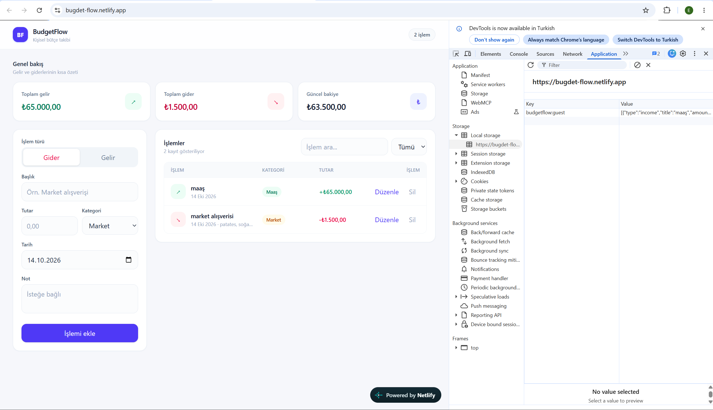

# BudgetFlow

BudgetFlow, gelir ve giderleri kaydetmek ve bütçe durumunu takip etmek için geliştirilmiş basit bir web uygulamasıdır. Web Geliştirme / JavaScript eğitimi proje ödevi için React ile hazırlanmıştır.

**Canlı uygulama:** https://bugdet-flow.netlify.app/



## Özellikler

- Gelir ve gider ekleme
- İşlemleri listeleme
- İşlemleri düzenleme ve silme
- İşlem arama ve filtreleme
- Toplam gelir, gider ve bakiye hesaplama
- Verileri tarayıcıda saklama (LocalStorage)
- Mobil cihazlara uyumlu tasarım

## Kullanılan Teknolojiler

- React
- Vite
- Tailwind CSS
- LocalStorage
- Netlify (yayın)

## Kurulum

Bilgisayarda Node.js ve npm kurulu olmalıdır.

```bash
git clone https://github.com/memreeger/budget-flow.git
cd budget-flow
npm install
npm run dev
```

Ardından terminalde gösterilen yerel adresi tarayıcıda açabilirsin.

## Üretim Derlemesi

```bash
npm run build
```

Derleme çıktısı `dist` klasörüne oluşur. Netlify'da build komutu olarak `npm run build`, yayın klasörü olarak `dist` kullanılmıştır.

## Proje Yapısı

```text
budgetflow/
|-- docs/
|   `-- screenShots/
|       `-- budgetFlow_SS.png
|-- src/
|   |-- components/
|   |   |-- EditTransactionModal.jsx
|   |   |-- SummaryCard.jsx
|   |   |-- TransactionForm.jsx
|   |   `-- TransactionList.jsx
|   |-- pages/
|   |   `-- Dashboard.jsx
|   |-- utils/
|   |   `-- storage.js
|   |-- App.jsx
|   `-- main.jsx
|-- index.html
`-- package.json
```

- `components/`: form, liste, özet kartı ve düzenleme penceresi gibi parçalar
- `pages/`: ana sayfa (`Dashboard`) tüm parçaları bir araya getirir
- `utils/storage.js`: LocalStorage okuma ve yazma işlemleri

## Ödev Karşılığı

| İstenen | Projede |
|---|---|
| Ekle | `TransactionForm` ile gelir veya gider eklenir |
| Listele | `TransactionList` ile işlemler tarihe göre listelenir |
| Güncelle | `EditTransactionModal` ile işlem düzenlenir |
| Sil | Silmeden önce onay istenir |
